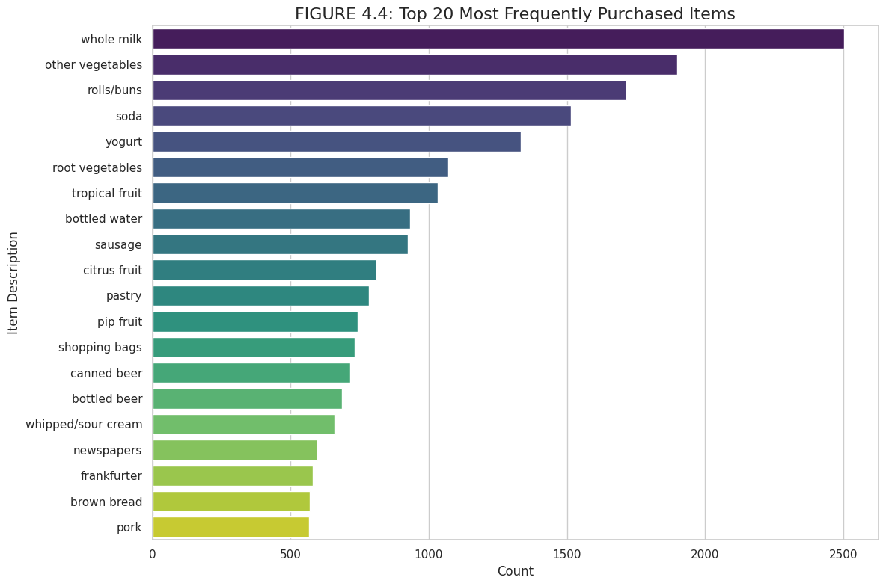
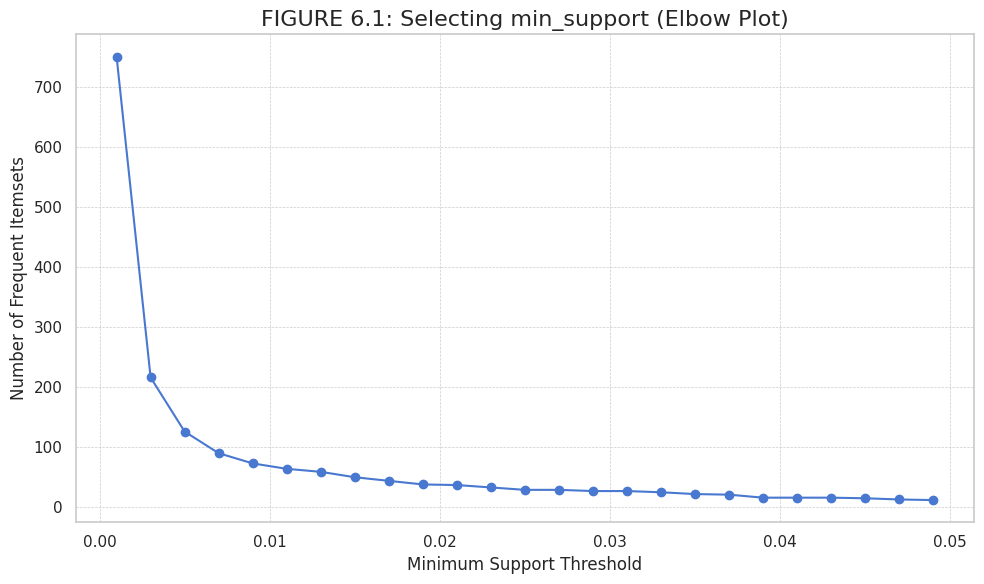
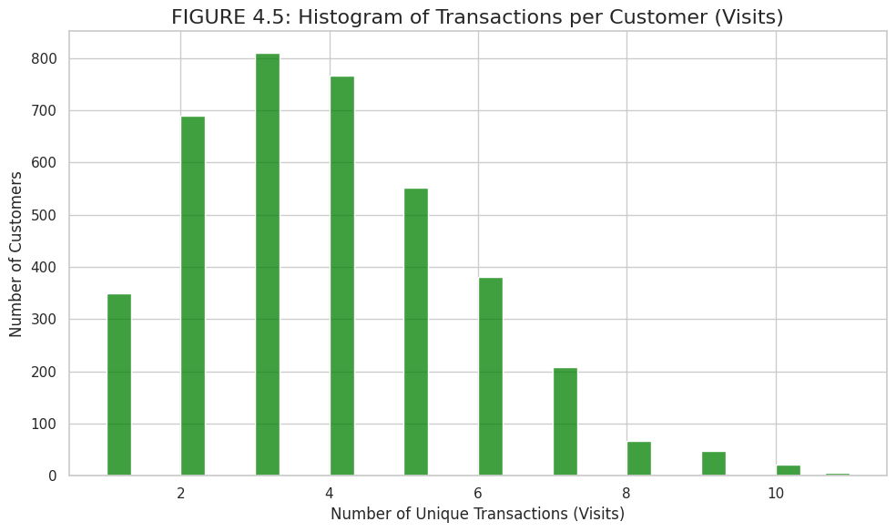
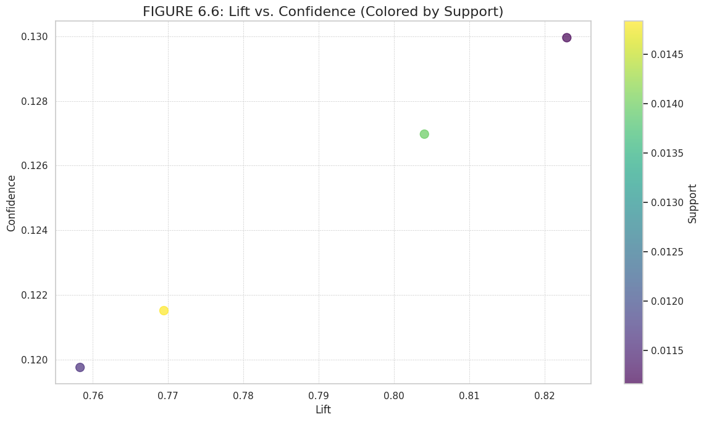
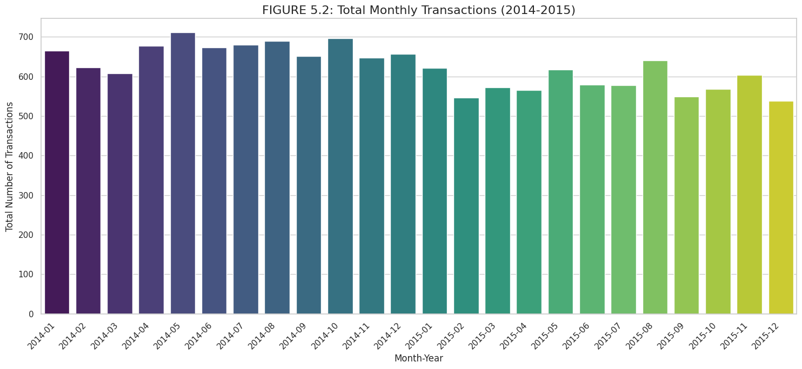
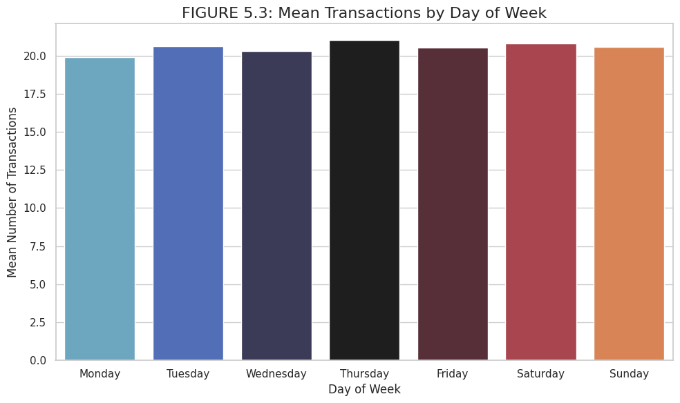

<div align="center">

# Grocery Market-Basket Analysis

**Apriori association-rule mining on 38,765 grocery purchases, and why the strongest rule turned out not to be a rule**

[](src/market_basket.py)
[](#method)
[](LICENSE)



</div>

---

## TL;DR

| | |
|---|---|
| **Data** | Kaggle *Groceries dataset*: **38,765** item purchases over 2014–2015, grouped into **14,963 baskets** across **167 products** |
| **Method** | Exploratory analysis, time-series views, one-hot basket matrix, Apriori with **min_support 0.01 chosen by an elbow plot**, association rules at confidence ≥ 0.1 |
| **Key finding** | Only 4 rules pass the thresholds, and **all 4 have lift below 1 (0.76–0.82)**. "Rolls/buns → whole milk" looks like a rule only because whole milk is in 15.8% of all baskets |
| **Takeaway** | Confidence alone is misleading for very popular items; lift (or conviction) has to gate any bundling decision |

> University coursework (ITS61504 Data Mining, Taylor's University, Nov 2025; module grade A-), individual assignment. I'm a third-year CS student and still learning; feedback is welcome.

## Method

1. **Load and inspect:** 38,765 rows, no missing values; dates parsed from `dd-mm-yyyy`.
2. **Exploratory analysis:** top 20 items, visits per customer (distinct shopping dates, not item rows), top customers.
3. **Time series:** daily, monthly and day-of-week transaction counts, monthly trends for the top 5 items.
4. **Baskets:** one basket = one member on one date → a 14,963 × 167 boolean matrix with `TransactionEncoder`.
5. **Choosing min_support:** I counted frequent itemsets across thresholds from 0.001 to 0.049 and picked the **elbow at 0.01**, where the count stops collapsing.
6. **Apriori + rules:** `mlxtend.apriori` then `association_rules` with confidence ≥ 0.1, ranked by confidence and by lift, plus scatter plots and a rule network.

<p>


</p>

## Results

**Most frequent items (support):** whole milk 0.158 · other vegetables 0.122 · rolls/buns 0.110 · soda 0.097 · yogurt 0.086.

**All rules at min_support 0.01 and confidence ≥ 0.1:**

| Rule | Support | Confidence | Lift |
|---|---|---|---|
| yogurt → whole milk | 0.0112 | 0.130 | 0.82 |
| rolls/buns → whole milk | 0.0140 | 0.127 | 0.80 |
| other vegetables → whole milk | 0.0148 | 0.122 | 0.77 |
| soda → whole milk | 0.0116 | 0.120 | 0.76 |

### Reading these rules correctly

Lift compares how often two items appear together with how often they would if purchases were independent. **A lift below 1 means the items co-occur *less* often than chance.** Every rule here points to whole milk simply because whole milk is in almost 16% of baskets, so it shows up next to everything. Confidence of 12–13% is actually *lower* than whole milk's baseline rate of 15.8%.

So these rules do **not** justify a "rolls + milk" bundle. Recognising that is the main result of this project for me, and it is something I got wrong in my original report, where I recommended bundling on the strength of confidence.



### What the time series shows

<p>


</p>

Demand is **remarkably flat**: about 20–21 transactions per day on every weekday, and monthly totals moving within a narrow band with no strong seasonal peak. My report claimed Saturday and Q4 peaks; re-reading the charts, the differences are too small to support staffing or inventory decisions without a statistical test.

**Customers:** most members visit 2–5 times in two years, and a small group visits 10 or more times, which is a better basis for a loyalty idea than any of the rules above.

## What I learned

- Always read **lift**, not just confidence, for popular items.
- A chart can contradict the story you wrote around it. Check the axis scale before calling a difference a "peak".
- Choosing min_support with an elbow plot is a reasonable heuristic, but it decides which rules can exist at all.

## Next steps

- [ ] Lower min_support (around 0.002) and filter rules by **lift > 1** and conviction to find genuine affinities
- [ ] Compare with FP-Growth for speed
- [ ] Test weekday differences statistically (for example, an ANOVA on daily counts) before recommending staffing changes
- [ ] Segment customers by visit frequency and mine rules per segment

## Run it

```bash
pip install -r requirements.txt
# download Groceries_dataset.csv from Kaggle (link below) into this folder
python src/market_basket.py --data Groceries_dataset.csv --out figures/
```

[`src/market_basket.py`](src/market_basket.py) is a cleaned single-script version of the Colab code shown in my report. One step the report does not show, building the daily transaction counts, is reconstructed and marked in the code.

Dataset: [Groceries dataset on Kaggle](https://www.kaggle.com/datasets/heeraldedhia/groceries-dataset).

## References

Agrawal, Imieliński & Swami, *Mining Association Rules between Sets of Items in Large Databases* (SIGMOD 1993) · Raschka, *MLxtend* (JOSS, 2018) · Brin et al., *Dynamic Itemset Counting and Implication Rules* (SIGMOD 1997), which introduced conviction

---

<sub>Built by Mazen Mehna as part of a BSc Computer Science (AI) at Taylor's University. MIT licensed.</sub>
